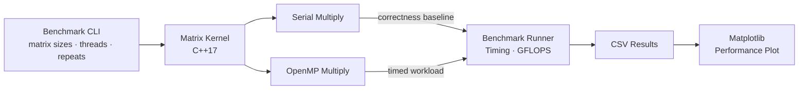

# Celia

Parallel CPU Benchmark

## What's going on here

Celia answers a simple question. How much faster does a program get when you give it more CPU cores? To find out, it multiplies big grids of numbers (called matrices) using 1 thread, then 2, then 4, and so on. It times each run and draws a chart of the results.

The chart shows something interesting. For small grids, extra threads barely help, and sometimes they even slow things down. For big grids, they help a lot.

- Written in C++ with OpenMP, which splits a loop across CPU cores
- Saves results to a CSV file
- Draws the chart with Python and Matplotlib

## How it works

- Celia multiplies square matrices with a plain triple loop on purpose
- The outer loop gets split across threads with OpenMP
- It tries every matrix size with every thread count you ask for
- Each setup runs several times, and the fastest run is kept
- Before timing anything, it checks that the parallel answer matches the serial one
- If they disagree, it prints a warning
- Speed is reported in seconds and in GFLOPS (billions of math operations per second)

The simple loop keeps the code easy to read. It also means the GFLOPS numbers are for comparing thread counts, not for showing off peak speed.



## Tech stack

- C++17 for the matrix math and benchmark logic
- OpenMP for multi-threading
- CMake for building
- Python and Matplotlib for the charts

## Why these technologies

- **C++17** runs close to the hardware, so timings reflect the CPU
- **OpenMP** adds threads with one line above a loop
- **CMake** builds on Windows, Mac, and Linux
- **CSV** opens in almost anything
- **Python and Matplotlib** draw the charts quickly

Here's how the pieces connect.


## Build

You'll need a C++17 compiler with OpenMP support, and CMake 3.10 or newer.

```bash
cmake -S . -B build -DCMAKE_BUILD_TYPE=Release
cmake --build build --config Release
```

That makes a `celia` program in `build/` (it's `celia.exe` on Windows).

## Run a benchmark

Here's an example run.

```bash
./build/celia --sizes 256,512,768,1024 --threads 1,2,4,8 --repeats 3 --output results.csv
```

You can change these options.

- `--sizes` sets the matrix sizes, as a comma-separated list (default `64,128,256,512`)
- `--threads` sets the thread counts to compare (default `1,2,4,8`)
- `--repeats` sets how many timed runs each setup gets (default `3`)
- `--output` sets where the CSV goes (default `results.csv`)

The CSV has one row per setup, like this example.

```text
matrix_size,threads,seconds,gflops
256,1,0.006,5.59
256,2,0.003,11.18
256,4,0.001,33.55
512,1,0.048,5.59
512,2,0.027,9.94
512,4,0.014,19.17
```

## Plot the results

First, install the plotting tools.

```bash
pip install -r scripts/requirements.txt
```

Then make the chart.

```bash
python scripts/plot_results.py results.csv -o results.png
```

- The chart plots time against matrix size
- Each thread count gets its own line
- That makes it easy to spot where extra threads start to pay off
- Add `--log-y` to put time on a log scale
- That helps when the big sizes dwarf the small ones

## Project layout

```text
celia/
├── CMakeLists.txt
├── src/
│   ├── matrix.hpp
│   ├── matrix.cpp
│   └── main.cpp
└── scripts/
    ├── plot_results.py
    └── requirements.txt
```

- `matrix.hpp` and `matrix.cpp` hold the matrix type and the serial and OpenMP multiplication
- `main.cpp` is the command line, the timing, the correctness check, and the CSV output
- `plot_results.py` turns the CSV into a chart
